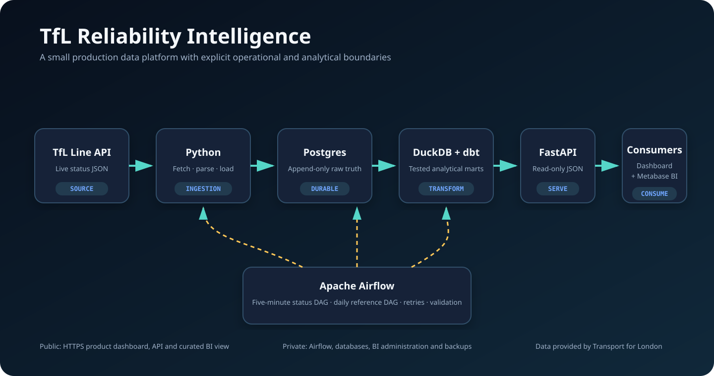
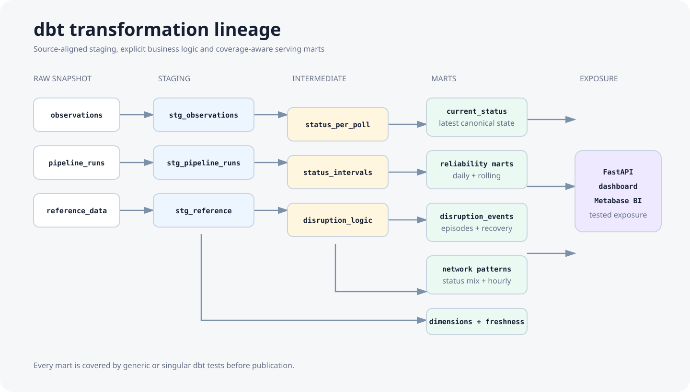

# TfL Intel: engineering a trustworthy reliability view

## Outcome

TfL Intel turns short-lived Line API status responses into an auditable history
of observed reliability across the Tube, Elizabeth line, DLR, London
Overground, and Tram. For someone planning a trip, it adds historical context
about a chosen line and weekday/hour to TfL's live journey planner. The local
vertical slice preserves raw evidence, builds tested marts, and serves a
coverage-aware dashboard; production operation has not yet been verified.

- Planned product URL: <https://tfl-intel.victorjohnson.dev>
- Planned API URL: <https://tfl-intel.victorjohnson.dev/docs>
- Planned BI URL: <https://tfl-bi.victorjohnson.dev>
- Private local Metabase fixture: <http://127.0.0.1:3001/dashboard/1>
- Source: <https://github.com/Victor-Johnson/tfl-intel>

## The problem

A live status response can say that the Central line has minor delays now, but
a traveler may also ask how often that line was *observed* disrupted on the
weekday and hour they expect to travel. A useful analytical system must show
how much of that history was actually collected; sparse observations are not
evidence of a reliable or unreliable future journey.

The project therefore measures three related things:

1. passenger-visible status observations;
2. continuous disruption episodes inferred from those observations; and
3. collection coverage, which communicates the confidence of every metric.

## System design



Airflow schedules two workflows. The five-minute workflow ingests line status,
builds a separate DuckDB candidate, runs dbt and validation, promotes the
snapshot, checks API readiness, then publishes BI marts. A daily workflow
refreshes reference dimensions.

Postgres stores ingestion runs, raw JSON, and append-style observations. It is
the durable source of truth. DuckDB provides a compact analytical snapshot.
dbt transforms that snapshot through staging and intermediate models into
dimensions, disruption facts, daily and rolling reliability, line-level
weekday/hour patterns, mode-level status mix, and freshness marts.

FastAPI opens a fresh read-only DuckDB connection per query. Its container has
no Postgres credentials, so serving cannot mutate or couple itself to the
ingestion database.

Metabase provides a second, trip-history surface. Airflow publishes only tested
marts into a Postgres analytics schema after validation. A dedicated role has
read-only access to that schema and no access to raw payloads. This deliberate
publication step avoids giving Metabase's persistent JDBC pool direct access
to the DuckDB file while it is refreshed. The private local Metabase dashboard
currently uses synthetic fixture data; it is not a deployed live product.

## Reliability semantics

One canonical status is selected for each line and five-minute polling bucket.
A status other than `Good Service` is treated as disrupted in V1. Consecutive
disrupted buckets form an episode; a return to good service resolves it, while
a collection gap longer than ten minutes breaks continuity.

Observed uptime is:

```text
good-service observed buckets / all observed buckets
```

It deliberately does not fill missing buckets as good or disrupted. Coverage
is reported independently against the expected five-minute observations in
each Europe/London calendar day (normally 288, or 276/300 on clock changes).
The dashboard warns below 90% seven-day coverage and describes
rankings as directional until that threshold is met.

These are analytical estimates derived from observations, not official TfL
service-level measures.

## Engineering highlights

### Safe retries and replay

The API client retries timeouts, rate limits, and server failures with bounded
backoff, but does not retry other client errors. Deterministic status
fingerprints and observation IDs deduplicate a replay of the same run ID;
a new poll intentionally records another observation. Database
constraints and `ON CONFLICT` handling provide the final enforcement layer.

### Observable failure paths

Each ingestion run is inserted as `started` before network work begins and ends
as `success` or `failed`, with timestamps, row counts, and an error message.
Pipeline freshness is consequently queryable data rather than a log-only
signal.

### Tested transformation contracts



dbt models declare grain and column expectations. Generic tests enforce keys,
relationships, accepted values, and nullability. Singular tests cover business
rules such as non-negative durations, valid reliability percentages, and one
row per expected grain. Runtime validation checks the published marts before
Airflow declares a refresh successful.

### Production-shaped delivery

Docker Compose separates core services, optional tools, Airflow, and production
policy. Only the API and authenticated Metabase service join the reverse-proxy
network. Postgres and Airflow bind to loopback, secrets remain outside Git,
logs rotate, both durable databases have backup scripts, and GitHub Actions
is configured to deploy after its quality gates pass. The production path
still needs a clean remote CI run and deployment proof.

## Demonstration path

1. Pick a line and inspect its current sampled status and age.
2. Select its ID in Metabase and inspect the weekday/hour pattern for a
   possible trip. Check both disrupted samples and collection coverage.
3. Compare the 90-complete-day trend; missing days appear with zero coverage,
   not as Good Service.
4. Inspect recent observed episodes and their unresolved/recovered state.
5. Use TfL Go for a live route and alternative before traveling; this project
   does not forecast a future disruption or plan a journey.
6. Trace a chart value to dbt, raw observations, and the preserved source
   payload; then demonstrate same-run replay and a failed-run recovery.

## Trade-offs and next steps

- DuckDB keeps this single-host project simple and inexpensive; a warehouse
  would be the natural move for concurrent writers or horizontal scale.
- Adding timetable and planned-work sources would allow scheduled operating
  minutes and planned/unplanned disruption to be modelled separately.
- Alert delivery is not yet integrated; freshness and failure signals already
  expose the inputs an alerting service would consume.
- Operational raw history is capped at 90 days only after a verified daily
  backup restore. Off-host backup and production retention behavior remain to
  be proven.
- The dashboard intentionally avoids a frontend build system. A larger product
  would split it into a separately versioned client.
- Predictive ML is intentionally deferred. The current platform first creates
  the reliable, coverage-labelled historical dataset that future models need.

## Attribution

Data provided by [Transport for London](https://tfl.gov.uk/info-for/open-data-users/).
TfL Intel is an independent, unofficial portfolio project and is not endorsed
by or affiliated with Transport for London.
