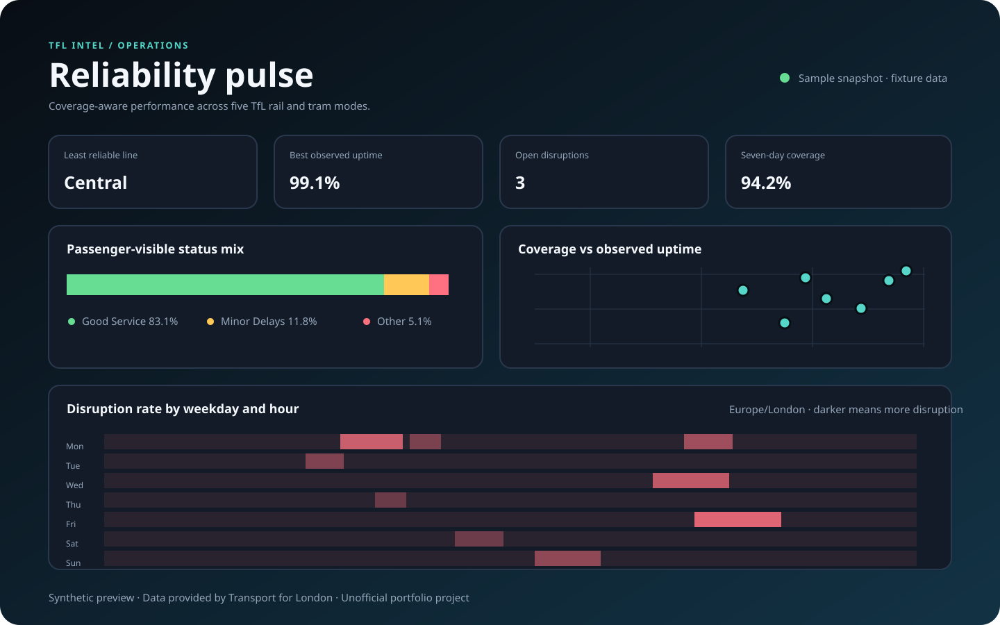
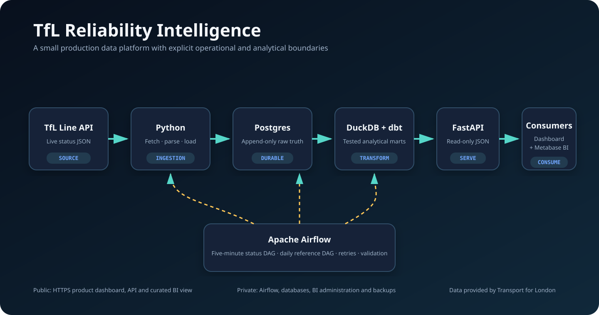
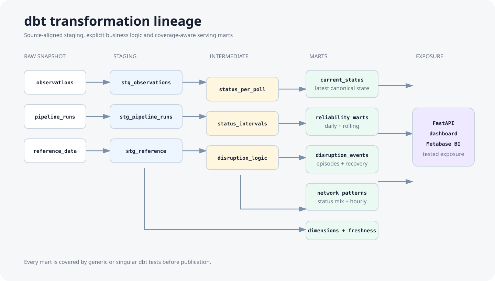

# TfL Reliability Intelligence

[](https://github.com/Victor-Johnson/tfl-intel/actions/workflows/ci.yml)
[](https://tfl-intel.victorjohnson.dev)
[](https://www.python.org/)

An end-to-end data and analytics engineering platform that captures status
snapshots for the Tube, Elizabeth line, DLR, London Overground, and Tram,
preserves their history, models observed reliability, and publishes the
results through a read-only API and dashboard.

**[Open the live dashboard](https://tfl-intel.victorjohnson.dev)** ·
**[Explore the API](https://tfl-intel.victorjohnson.dev/docs)** ·
**[Explore the BI workspace](https://tfl-bi.victorjohnson.dev)** ·
**[Read the case study](PORTFOLIO.md)** ·
**[Deployment guide](DEPLOYMENT.md)**



> The preview uses synthetic fixture values. The live deployment reports data
> collected by its own scheduled pipeline.

## The 30-second version

TfL's Line API describes the present, but a status disappears when conditions
change. This project polls five rail and tram modes every five minutes and
builds the missing history needed to answer questions about disruption
episodes, observed uptime, recovery time, status mix, time-of-week patterns,
collection coverage, and pipeline freshness.

| Capability | Evidence in this repository |
|---|---|
| Reliable ingestion | Typed parsing, selective retry, deterministic IDs, idempotent writes |
| Operational storage | Append-style Postgres raw tables and queryable pipeline runs |
| Analytics engineering | dbt staging, intermediate, dimension, fact, and mart models |
| Data quality | Contracts, generic tests, singular business-rule tests, runtime validation |
| Orchestration | Five-minute and daily Airflow DAGs with retry and publication gates |
| Serving | FastAPI product dashboard plus a read-only Metabase exploration layer |
| Delivery | GitHub Actions CI/CD, Docker Compose, HTTPS proxy contract, backups |

## Architecture



```text
TfL Line API -> Python ingestion -> Postgres raw system of record
  -> DuckDB snapshot -> dbt marts -> FastAPI -> product dashboard
                              \-> read-only Postgres publication -> Metabase
                         ^
                         |
                      Airflow orchestration and validation
```

Postgres owns durable operational history. DuckDB is a rebuildable analytical
read model. dbt owns transformation semantics and tests. FastAPI can read the
published file but receives no Postgres credentials, enforcing the serving
boundary through deployment rather than convention.

After validation, Airflow atomically publishes an allowlist of ten marts into
Postgres for Metabase. The dedicated `metabase_reader` role can query only the
analytics schema. This avoids sharing the actively refreshed DuckDB file with a
long-lived JDBC connection pool.

## Decisions worth discussing

### Idempotency is part of the data model

Status and observation identifiers are deterministic SHA-256 values derived
from their natural inputs. Replaying an ingestion batch therefore produces the
same keys, and `ON CONFLICT DO NOTHING` makes retries safe. A Postgres
integration test proves the second write inserts zero rows.

### Missing data is not good service

The dashboard reports **observed uptime**, not an official TfL SLA. Only
collected five-minute buckets enter the uptime calculation. Missing buckets are
reported separately as coverage, and rankings are labelled insufficient or
provisional until enough evidence exists.

### Raw and analytical workloads are separated

Ingestion writes raw payloads and run metadata to Postgres. Airflow creates a
DuckDB snapshot, then dbt builds tested marts. Dashboard traffic cannot slow or
mutate ingestion, and the analytical file can be rebuilt from the raw source of
truth.



## Local quick start

Requirements: Docker Engine with Compose, `uv`, at least 4 GB of available
memory for the Airflow stack, or 6 GB when running Airflow and Metabase
together.

```bash
uv sync --all-groups
cp .env.example .env
mkdir -p secrets
cp secrets.example/postgres_password.txt.example secrets/postgres_password.txt
cp secrets.example/airflow_db_password.txt.example secrets/airflow_db_password.txt
cp secrets.example/metabase_app_db_password.txt.example secrets/metabase_app_db_password.txt
cp secrets.example/metabase_reader_password.txt.example secrets/metabase_reader_password.txt
```

Replace the example passwords, then run the complete path:

```bash
make compose-config
make airflow-up
make postgres-init
make ingest-reference-data
make ingest-line-status
make duckdb-refresh
make validate-marts
```

Open the dashboard at `http://localhost:8000/dashboard`, API documentation at
`http://localhost:8000/docs`, Airflow at `http://localhost:8080`, and Metabase
at `http://localhost:3000`. See [the Metabase setup guide](docs/metabase/README.md)
for the curated BI dashboard.

## API

```text
GET /
GET /dashboard
GET /health
GET /ready
GET /api/v1/lines/current-status
GET /api/v1/lines/status-summary
GET /api/v1/lines/{line_id}/history?limit=50
GET /api/v1/lines/reliability?min_coverage_pct=0
GET /api/v1/lines/{line_id}/reliability/daily?days=30
GET /api/v1/disruptions?line_id=central&resolved=true&limit=100
GET /api/v1/network/reliability-by-mode?days=30
GET /api/v1/network/status-mix?days=30&mode_name=tube
GET /api/v1/network/disruption-heatmap?days=30&mode_name=tube
GET /api/v1/pipeline/latest-run
GET /api/v1/pipeline/freshness
```

`/health` reports process liveness. `/ready` verifies that the DuckDB file and
all required analytical tables exist. `/` redirects portfolio visitors to the
dashboard.

## Quality gates

```bash
make check                     # Ruff, mypy, Python tests, dbt build/tests
uv run pytest -m integration   # real Postgres idempotency and failure paths
make compose-config            # merged local Compose validation
```

CI runs the unit/component suite, real Postgres integration tests, dbt build,
production Compose validation, and image builds before deployment is eligible.

## Repository map

```text
airflow/dags/        scheduled pipeline definitions
dbt/models/          staging, intermediate, dimensions, facts, and marts
docs/metabase/        curated BI questions and secure setup instructions
src/tfl_intel/       ingestion and read-only serving packages
sql/postgres/        idempotent raw-store DDL
scripts/             pipeline, deployment, validation, and backup entrypoints
docs/                decisions, runbook, portfolio material, and source audit
```

## Honest limitations

- Reliability is inferred from API observations, not train movements or an
  official service-level measure.
- Planned closures currently count as disruptions because the selected source
  contract does not provide a dependable planned/unplanned flag.
- Expected daily coverage assumes 288 five-minute buckets across a calendar
  day, not line-specific operating timetables.
- DuckDB is appropriate for this single-writer portfolio deployment, not a
  horizontally scaled multi-writer service.
- The first seven-day rankings remain provisional while history accumulates.
- Line status is the deliberate V1 data domain. Ridership, arrivals, and
  predictive ML features are not mixed into the reliability metric; ML is a
  future layer once sufficient labelled history exists.

## Data attribution

Data provided by [Transport for London](https://tfl.gov.uk/info-for/open-data-users/).
This is an independent, unofficial portfolio project and is not endorsed by or
affiliated with Transport for London. No official TfL logos or roundels are
used.
