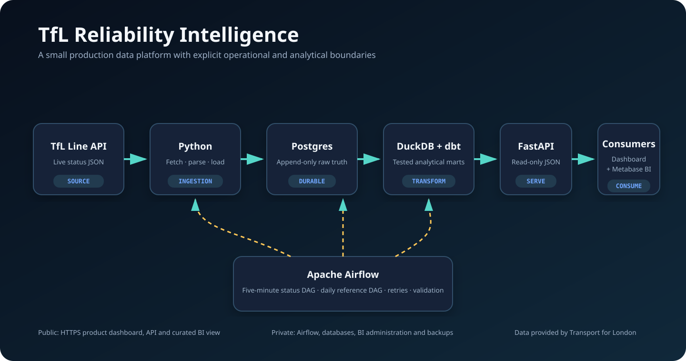
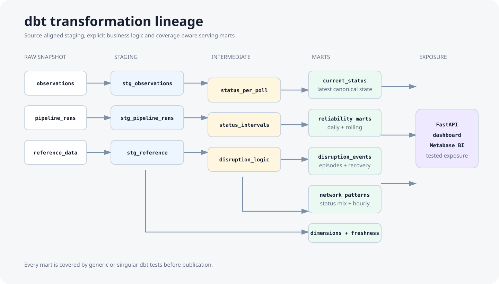
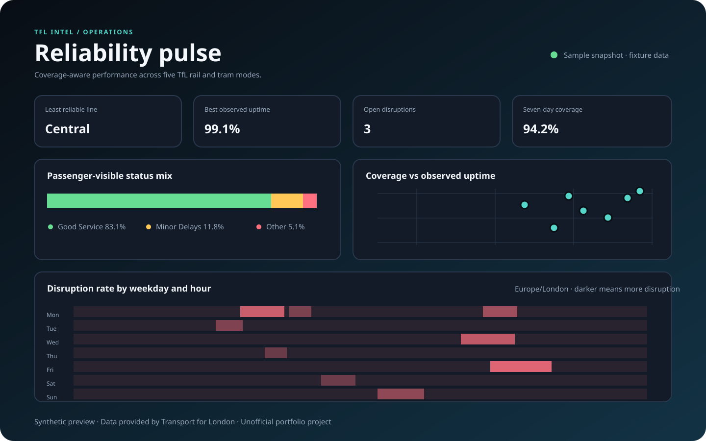

# Building a Coverage-Aware Reliability Platform for the London Underground

TfL can tell you whether a line has delays right now. Once that status changes,
the old answer disappears. I wanted to build the missing historical layer: a
system that could explain what was observed, when disruption episodes occurred,
and how much confidence to place in the result.

The final project is a deliberately compact production data platform covering
the Tube, Elizabeth line, DLR, London Overground, and Tram:

```text
TfL Line API → Python → Postgres → DuckDB → dbt → FastAPI → dashboard
                                           ↘ Postgres BI → Metabase
                              ↑
                        Apache Airflow
```

It runs on one VPS, but it still treats replay safety, data quality, trust
boundaries, deployment and recovery as first-class concerns.



## Starting with the grain

The source returns one line with one or more status entries. Before choosing
tools, I defined the raw grain as one observed line-status entry produced by one
ingestion run.

That definition led to two deterministic identifiers. A status fingerprint
hashes the line, status, reason and validity window. An observation identifier
combines that fingerprint with the ingestion-run identifier. Replaying exactly
the same batch therefore generates exactly the same keys.

Postgres enforces the design with a primary key and `ON CONFLICT DO NOTHING`.
This matters because retries are normal in data systems. Idempotency should not
depend on remembering to run a cleanup script after a partial failure.

The integration suite proves the behaviour against real Postgres: the first
load inserts the observation and a replay inserts zero new rows.

## Keeping raw evidence

The ingestion job stores both parsed columns and the original JSON payload.
That is a small storage cost for a useful guarantee: if parsing logic changes,
the historical source evidence remains available for reprocessing.

Each run is also data. A row is committed as `started` before the network call,
then updated to `success` or `failed` with timestamps, record counts and an
error message. A crash is not merely a line in a container log; it becomes an
observable state that the freshness mart and API can expose.

The HTTP client retries timeouts and server failures with bounded exponential
backoff. It does not retry client errors, because repeatedly sending an invalid
request adds load without improving the chance of success.

## Why Postgres and DuckDB both belong here

Using two databases in a portfolio project can easily become architecture for
architecture's sake. In this case they have intentionally different jobs.

Postgres is the operational system of record. It handles transactions,
append-style observations, run metadata and concurrent ingestion safely.

DuckDB is the analytical read model. Airflow replaces its raw snapshot from
Postgres and dbt builds the serving marts inside the same file. Analytical
queries stay away from ingestion, and the complete file can be rebuilt from
the durable source.

The API container mounts that DuckDB volume read-only and receives no Postgres
credentials. The boundary is enforced by deployment, not just a comment saying
that the API should avoid writes.

## Modelling reliability without inventing evidence

The hardest question was not SQL syntax. It was what “reliability” should mean
when collection is incomplete.

I select one canonical status per line and five-minute bucket. A non-`Good
Service` status counts as disrupted for V1. Consecutive disrupted buckets form
an episode; a return to good service resolves it, while a gap longer than ten
minutes breaks continuity.

Observed uptime is calculated only from buckets the platform actually saw:

```text
good-service observed buckets ÷ all observed buckets
```

Coverage is separate:

```text
observed buckets ÷ 288 expected five-minute buckets per calendar day
```

If the collector ran for only an hour, the platform might have seen 100% good
service, but it cannot claim that the line had 100% uptime for the day. The UI
therefore shows both numbers and labels seven-day rankings insufficient,
provisional or reliable based on coverage.

This metric is explicitly called **observed uptime**. It is an analytical
estimate from status snapshots, not an official TfL SLA and not a measurement
of individual train movements.

## dbt as the publication contract

The transformation graph moves from source-aligned staging models into
canonical polling buckets and status intervals, then publishes dimensions,
disruption facts, daily reliability, rolling reliability, mode-level status
mix, weekday/hour disruption patterns, and pipeline freshness.



Generic tests cover keys, relationships, nullability and accepted values.
Singular tests enforce business rules: disruption duration cannot be negative,
reliability percentages stay in range, and daily and rolling marts preserve
their declared grain.

Airflow runs dbt as part of the five-minute DAG. A separate runtime validator
checks the published tables before the workflow calls the API readiness route.
This makes successful publication stronger than “the SQL process exited with
zero.”

## Giving the pipeline a visible product

The read-only FastAPI layer exposes current status, history, reliability,
disruption events, mode summaries, status mix, hourly patterns, and freshness.
A zero-build HTML dashboard consumes the same contract, so a reviewer can
understand the result without setting up a local environment.

For deeper exploration, the pipeline also publishes an explicit allowlist of
validated marts into a Postgres analytics schema for Metabase. Its database
role is read-only and cannot access raw payloads. I chose this publication
boundary instead of attaching Metabase directly to DuckDB: a long-lived JDBC
connection pool should not contend with the process replacing the analytical
file every five minutes.



The dashboard leads with the confidence signal. It warns when the latest
snapshot is stale and when collection coverage is too low for dependable
ranking. Reviewers can filter five modes, compare weighted uptime, scan the
passenger-visible status distribution, inspect the relationship between
coverage and uptime, and find time-of-week disruption patterns in a heatmap.
That is more honest—and more useful—than putting a precise percentage on
incomplete data without qualification.

## Operating it on one VPS

The production deployment uses Docker Compose on an Ubuntu/Debian VPS. Nginx
Proxy Manager terminates HTTPS for `tfl-intel.victorjohnson.dev` and
`tfl-bi.victorjohnson.dev`. FastAPI and Metabase join the proxy network;
Postgres and Airflow stay private and bind to loopback.

GitHub Actions runs formatting, linting, typing, unit/component tests, real
Postgres integration tests, dbt tests, Compose validation and container builds.
Only a passing `main` revision can deploy. The remote deployment records the
previous revision and restores it if bootstrap or readiness fails.

Postgres receives a daily custom-format dump with seven daily and four weekly
copies retained locally. DuckDB is not treated as authoritative backup data;
it is rebuilt from Postgres after restoration.

## What I would change at larger scale

DuckDB is a strong fit for one scheduled writer and a low-traffic portfolio
API. Multiple writers or horizontally scaled serving would justify moving the
analytical layer to a managed warehouse.

The next data improvement would be adding timetables and planned-work sources.
That would let expected coverage follow operating hours and would separate
planned closures from unplanned disruption. Alert delivery is another natural
extension; freshness and failed-run data already provide the necessary signal.
Predictive ML is deliberately deferred until the platform has accumulated
enough coverage-labelled history to train and evaluate without leakage.

The most important lesson was simpler: a reliability number is only as honest
as its denominator. Building coverage into the model, API and interface made
the project more trustworthy than a more elaborate dashboard ever could.

Explore the [live dashboard](https://tfl-intel.victorjohnson.dev) or read the
[source and full technical documentation](https://github.com/Victor-Johnson/tfl-intel).

---

Data provided by [Transport for London](https://tfl.gov.uk/info-for/open-data-users/).
This is an independent, unofficial portfolio project and is not endorsed by or
affiliated with Transport for London.
